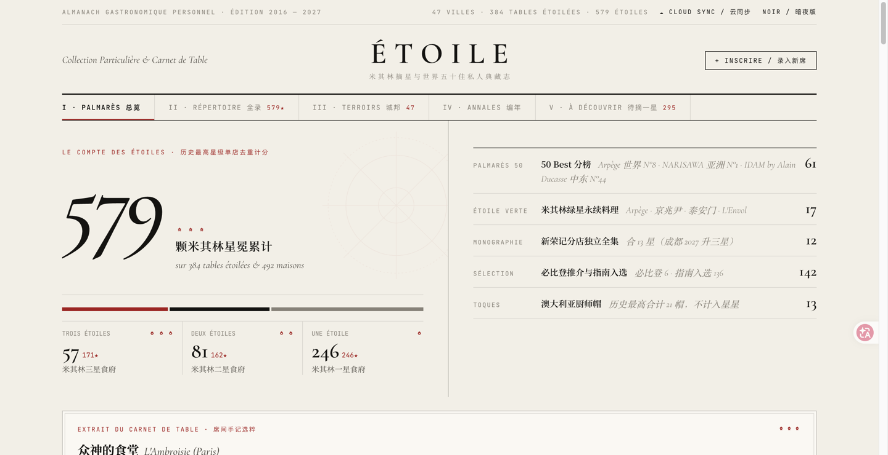

# ÉTOILE — Personal Michelin & World's 50 Best Almanac

<p align="center">
  <b>An editorial-grade, zero-backend fine dining almanac &amp; travel journal PWA — deploy your own on GitHub Pages in 3 minutes</b>
</p>

<p align="center">
  <a href="https://leotyndale.github.io/etoile-almanach/"></a>
  <a href="https://github.com/leotyndale/etoile-almanach/stargazers"></a>
  <a href="LICENSE"></a>
  <a href="README_ZH.md"></a>
</p>

<p align="center">
  <a href="https://leotyndale.github.io/etoile-almanach/">
    
  </a>
</p>

---

## Live Demo Showcase

👉 **[Explore the Live Demo](https://leotyndale.github.io/etoile-almanach/)** — populated with a real-world **10-year gastronomic ledger**:
- **47 Cities** across Greater China, Japan, Southeast Asia, Europe, and North America
- **384 Starred Tables** totaling **579 Michelin Stars** (57 Three-Star · 81 Two-Star · 246 One-Star) + **17 Green Stars**
- **61 World's / Asia's / MENA's 50 Best** appearances & **13 AGFG Chef Hat** entries
- Dual **Ivory Archival** & **Noir** editorial themes + **Installable PWA** (`manifest.json` + `sw.js`)

---

## Key Features

- **Zero Backend, Zero Build Step**: Pure HTML + Vanilla JS + CSS — no Node.js build pipeline, no database server, \$0 hosting on GitHub Pages.
- **Local-First Privacy**: Your personal tasting notes, wine pairings, companions, and dining photos never touch a third-party server — they stay in `localStorage` inside your browser.
- **Optional GitHub Gist Cloud Sync**: Sign in once with a personal GitHub Gist token in the UI (`CLOUD SYNC`) to encrypt/sync your private `etoile-notes.json` across desktop and phone.
- **5-Tab Editorial Almanac**:
  1. **I · Palmarès**: Executive Michelin star tally, Three/Two/One star breakdown, 50 Best & Green Star highlights.
  2. **II · Répertoire**: Searchable & filterable full restaurant directory with yearly star history matrix.
  3. **III · Terroirs**: City-by-city breakdown with geographic coordinates and top tables.
  4. **IV · Annales**: Year-by-year dining chronicle timeline.
  5. **V · À Découvrir**: Personal wishlist & undiscovered Michelin targets.

---

## Make Your Own Dining Almanac in 3 Minutes

### Step 1: Create your own copy

Click the green **"Use this template"** button at the top of this repository (or **Fork** it) to create `<your-username>/etoile-almanach`.

### Step 2: Reset to the clean 3-restaurant starter dataset (optional)

Clone your new repository and run the included template initializer:

```bash
git clone https://github.com/<your-username>/etoile-almanach.git
cd etoile-almanach
python3 scripts/init-template.py --title "MA TABLE" --years "2024 — 2027"
```

This swaps `data/bootstrap.json` with `data/sample.bootstrap.json` (3 clean starter entries: Paris, Tokyo, Hong Kong) and updates your masthead title in `index.html`.

> Want to preview before committing? Run `python3 -m http.server 8080` and open `http://localhost:8080`.

### Step 3: Enable GitHub Pages

1. Open your repository **Settings → Pages**.
2. Under **Build and deployment**, select **Deploy from a branch** → `main` / `/ (root)`.
3. Visit `https://<your-username>.github.io/etoile-almanach/` — your personal almanac is live!
4. Click **+ INSCRIRE** in the top-right corner anytime to log new visits, or connect **CLOUD SYNC** with a GitHub Gist PAT to sync notes across devices.

---

## Architecture & Data Model

```text
etoile-almanach/
├── index.html                  # Editorial layout & 5-tab navigation shell
├── styles.css                  # Ivory / Noir high-contrast archival typography
├── app.js                      # Rendering engine, filters, chronicle & detail modal
├── store.js                    # Local-first persistence + optional GitHub Gist sync
├── manifest.json / sw.js       # Offline-capable PWA shell
├── data/
│   ├── bootstrap.json          # Active public ledger loaded by GitHub Pages
│   ├── sample.bootstrap.json   # Clean 3-entry starter dataset for template users
│   ├── catalog.json            # Reference Michelin/50 Best search catalog
│   └── region_unmatched.json   # Unmatched dining records ledger
└── scripts/
    └── init-template.py        # One-command reset & branding customizer
```

---

## Author & Related Projects

Built by **Yunpeng Li (`leotyndale`)** — TCC Member (130+ countries), 1.8W+ Dianping creator, Android GDE, Author of *《移动开发架构设计实战》*.

| Project | Description | Stars |
| --- | --- | --- |
| [**mobile-agent-skills**](https://github.com/leotyndale/mobile-agent-skills) | Production AI Coding Agent Skills for Android, iOS, Flutter & Mobile Architecture |  |
| [**EnFloatingView**](https://github.com/leotyndale/EnFloatingView) | Permission-free in-app floating window for Android |  |
| [**AppArchitecture**](https://github.com/leotyndale/AppArchitecture) | 2026 Mobile Architecture Playbook & companion code |  |

If you enjoy this design or use it for your own travel & dining journal, please give it a **Star ⭐**!

Licensed under the [MIT License](LICENSE).
