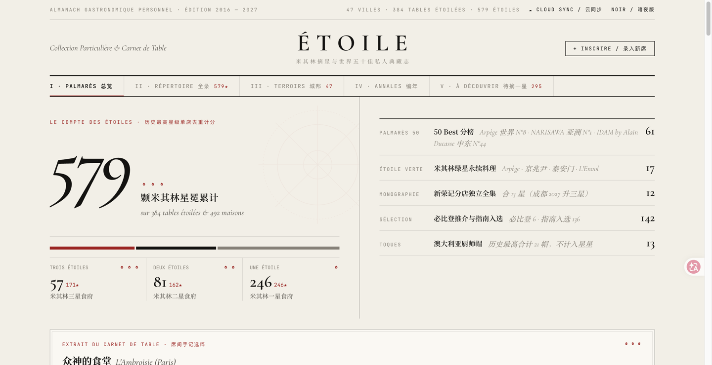

# ÉTOILE 摘星志 — 个人米其林与 World's 50 Best 典藏指南模板

<p align="center">
  <b>零后端、高颜值杂志级排版、支持 PWA 离线与 GitHub Gist 同步的个人美食/旅行打卡开源模板（3 分钟部署上线）</b>
</p>

<p align="center">
  <a href="https://leotyndale.github.io/etoile-almanach/"></a>
  <a href="https://github.com/leotyndale/etoile-almanach/stargazers"></a>
  <a href="LICENSE"></a>
  <a href="README.md"></a>
</p>

<p align="center">
  <a href="https://leotyndale.github.io/etoile-almanach/">
    
  </a>
</p>

---

## 在线真迹展示（Live Demo）

👉 **[立即访问在线站点](https://leotyndale.github.io/etoile-almanach/)** —— 内置作者十年真实环球摘星账本作为展示数据：
- 覆盖全球 **47 座城市**、**384 家星级食府**、累计 **579 颗米其林星冕**（57 三星 · 81 二星 · 246 一星）及 **17 颗绿星**
- 收录 **61 家 World's / Asia's / MENA's 50 Best** 上榜餐厅与 **13 家澳大利亚厨师帽**
- 支持 **象牙纸本（Ivory） / 暗夜典藏（Noir）** 双主题切换，支持添加到手机主屏幕作为 **PWA** 独立应用使用

---

## 核心特性

- **零后端、零打包构建**：纯原生 HTML + CSS + JavaScript，不需要 Node.js / Webpack，直接托管在 GitHub Pages，成本为 **0**。
- **Local-First 隐私优先**：私人食评、配酒笔记、同席旅伴与菜品照片默认仅保存在你的浏览器 `localStorage` 中，不经过任何第三方服务器。
- **可选 GitHub Gist 云同步**：在右上角 `CLOUD SYNC / 云同步` 中填入个人 Gist Token，即可在电脑和手机间安全同步你的私人笔记 `etoile-notes.json`。
- **五大编辑部级视图**：**I · 总览**（星数去重计分与榜单分布）、**II · 全录**（多维度检索与历年星级矩阵）、**III · 城邦**（城市维度汇总）、**IV · 编年**（按年份回顾打卡轨迹）、**V · 待摘星**（心愿单管理）。

---

## 3 分钟拥有你自己的「美食 / 摘星年鉴」

### 第 1 步：点击模板生成你的仓库

点击仓库顶部的绿色按钮 **「Use this template」**（或点击 **Fork**），生成属于你自己的 `<你的用户名>/etoile-almanach` 仓库。

### 第 2 步：一键重置为 3 家示例餐厅与你的专属刊名

```bash
git clone https://github.com/<你的用户名>/etoile-almanach.git
cd etoile-almanach
python3 scripts/init-template.py --title "MY ALMANAC" --years "2024 — 2027"
```

脚本会自动用轻量干净的 `data/sample.bootstrap.json`（含巴黎、东京、香港 3 家示例餐厅）替换 Demo 数据，并修改 `index.html` 的刊头标题与年份。

本地预览效果：
```bash
python3 -m http.server 8080
```

### 第 3 步：开启 GitHub Pages 免费上线

1. 进入你仓库的 **Settings → Pages**。
2. **Build and deployment** 选择 **Deploy from a branch** → `main` / `/ (root)`。
3. 几十秒后访问 `https://<你的用户名>.github.io/etoile-almanach/` 即可上线，点右上角 `+ INSCRIRE / 录入新席` 就能随时记录！

---

## 作者与关联项目

由 **李云鹏 (`leotyndale`)** 创作维护 —— TCC 世纪俱乐部会员（游历 130+ 国）、大众点评 1.8W+ 粉创作者、Android GDE、《移动开发架构设计实战》作者。

| 项目 | 简介 | Stars |
| --- | --- | --- |
| [**mobile-agent-skills**](https://github.com/leotyndale/mobile-agent-skills) | 面向 Android / iOS / Flutter 与移动端架构师的生产级 AI Coding Agent 技能库 |  |
| [**EnFloatingView**](https://github.com/leotyndale/EnFloatingView) | 无需一切权限的 Android 应用内悬浮窗 |  |
| [**AppArchitecture**](https://github.com/leotyndale/AppArchitecture) | 2026 移动端架构工程实践指南与随书源码 |  |

如果这个模板或设计灵感帮到了你，欢迎点个 **Star ⭐** 支持！基于 [MIT License](LICENSE) 开源。
